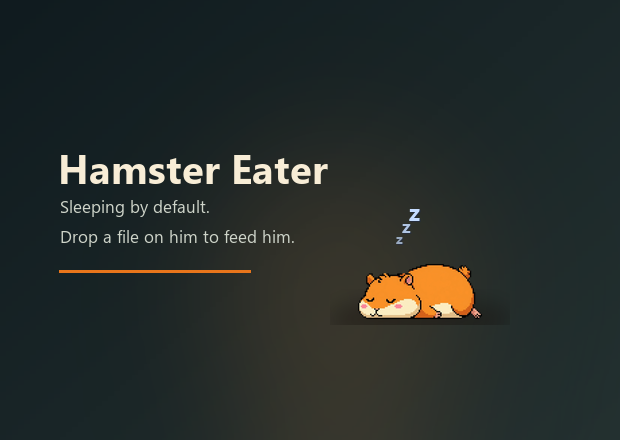

# Hamster Eater – desktop hamster prototype

Reference material for HAMSTER (issue #36), handed over by the operator for the Lead. Not part of the product and not in the release package (the release removes `docs/`).

## What it does

A frameless, always-on-top Windows window with a sleeping pixel hamster. Drop files on it and it wakes, eats them and goes back to sleep. Several files queue up, folders are refused. Click to pet it, drag to move it, right-click for the menu.

**It does not upload anything:** a dropped file goes to the Windows Recycle Bin (`TrashFile` in `HamsterEater.cs`). Don't try it on a file you still need in place.

## What differs from #36

| | Prototype | #36 |
|---|---|---|
| Technology | C# / WPF, Windows only | Tauri, Windows, then macOS and Linux |
| Dropped file | Recycle Bin | Upload to the user's own server |
| Setup | None | Server address and personal key |
| Location | This folder | Its own repository |

Worth carrying over: the moods and their timing, the speech bubbles, crumbs and hearts, and the art.

## Files

| File | What |
|------|------|
| `HamsterEater.cs` | Whole source. A `SMOKE` compile symbol adds a timed self-test |
| `HamsterEater.exe` | Built program, frames embedded. Unsigned, so Windows may warn |
| `hamster.ico`, `preview.png` | Icon and preview picture |
| `frames/` | The frames the program loads: `sleep`, `wake`, `happy`, `eat_01`…`eat_08` |
| `Gemini_Generated_Image_*.jpg` | Source art, generated with Google Gemini. The files carry Google's C2PA provenance data, left in place |

The source folder had no build script. The source needs WPF and `Microsoft.VisualBasic`, and loads the frames as embedded resources named `sleep.png`, `eat_01.png` and so on.
